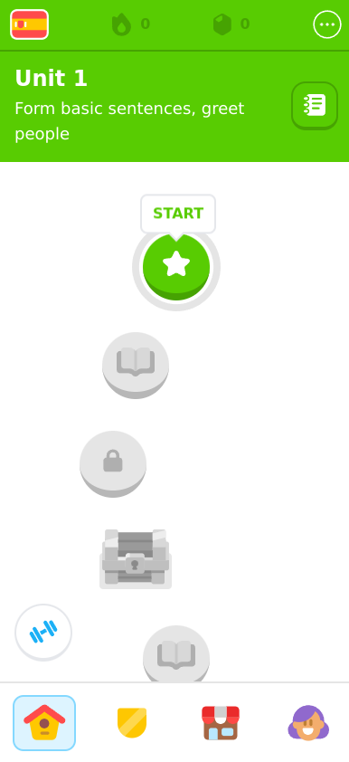
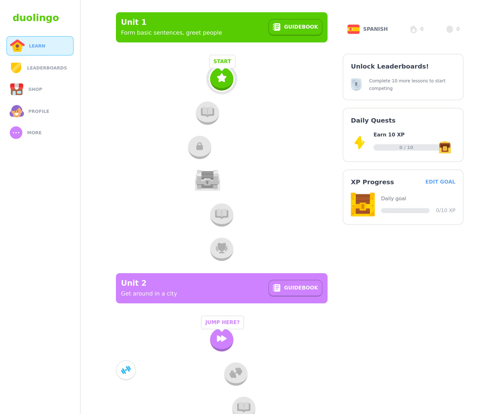

# Mini Maker Labs

Plataforma educativa de electrónica, robótica y proyectos Maker para niñas y niños.

Construida con [React](https://react.dev/), [TypeScript](https://www.typescriptlang.org/), [Next.js](https://nextjs.org/), [Tailwind](https://tailwindcss.com/) y [Zustand](https://github.com/pmndrs/zustand).

